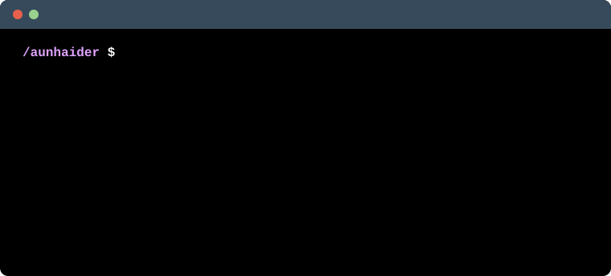

<!-- ============================================================
  SETUP: replace every YOUR_GITHUB_USERNAME, LEETCODE_USERNAME,
  CODEFORCES_HANDLE and the links in "Find me" with your own.
  ============================================================ -->

<!-- Animated hero: ASCII face + compiler-style about me.
     Regenerate with: python generate_hero_svg.py -->

  

<!-- Animated "real-time coding" window. Generated by generate_typing_svg.py -->

  

---

## 🧰 Tech Stack

  
   
  
   
  

## 🔭 Currently Exploring

- ⚡ Advanced Data Structures & Algorithms
- 🧠 System design fundamentals
- 🐳 Docker & CI/CD with GitHub Actions
- 🤖 Building with LLM APIs
- ☁️ Cloud basics (AWS / Vercel)

---

## 📊 GitHub Stats

  
  

  

## 🐍 Contribution Snake

  <picture>
    <source media="(prefers-color-scheme: dark)" srcset="https://raw.githubusercontent.com/YOUR_GITHUB_USERNAME/YOUR_GITHUB_USERNAME/output/github-snake-dark.svg"/>
    <source media="(prefers-color-scheme: light)" srcset="https://raw.githubusercontent.com/YOUR_GITHUB_USERNAME/YOUR_GITHUB_USERNAME/output/github-snake.svg"/>
    
  </picture>

## 🏆 Competitive Programming

  

  

---

## 🌐 Find Me

  
  
  
  
  
  

  

